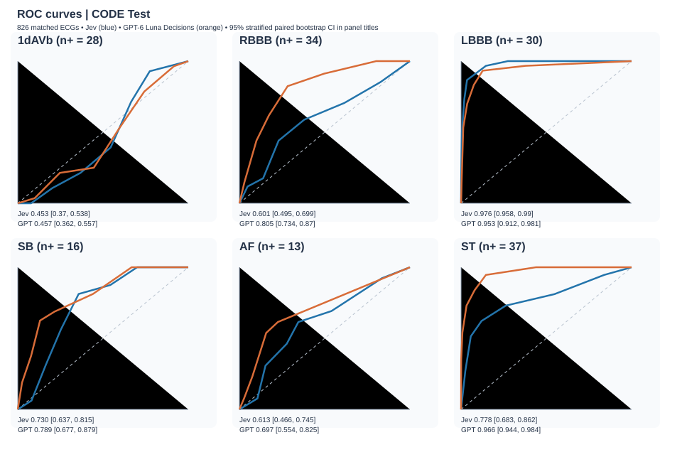
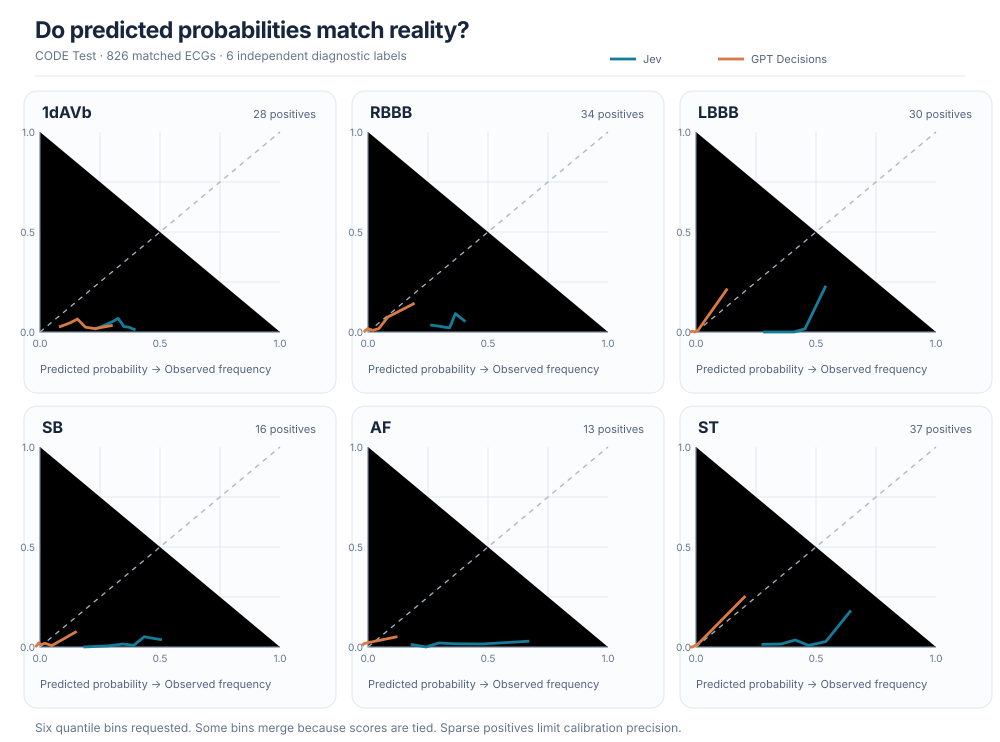

I wanted to try a simple question: **can an AI system designed to make structured decisions recognize ECG findings from an image, without a specialized ECG classifier?**

ECGs are not ordinary photographs. Reading one involves rhythm, intervals, wave shapes and relationships across twelve leads. A model can produce a perfectly valid answer while being completely wrong about the heart.

This is a research experiment, not a clinical diagnostic system. All code and the public test images are linked below.

## What do I mean by System-One AI?

In this post, *system-one* is a practical description of models and APIs optimized for fast, structured decisions rather than long free-form explanations. It is **not** evidence that a neural network literally implements the human psychological concept of System 1.

I compared two APIs:

- **[Jev 1.14.0](https://www.typesafe.ai/)**, a typed decision model from TypeSafe AI. Each question returns YES or NO and probabilities for both choices.
- **[GPT-6 Luna Decisions](https://platform.openai.com/docs/)**, OpenAI's typed Decisions API, which also accepts an image and returns a typed choice with probabilities.

The attraction of these interfaces is that we can ask six explicit questions and get six machine-readable answers. But a well-formed JSON response does not imply medical accuracy or calibrated confidence.

## The CODE Test dataset

We used **827 ECG examinations** from the CODE Test subset, with reference labels for six conditions. The original ECGs are time-series recordings. For this experiment, we use rendered 12-lead images, not the underlying numerical signals.

The test images and reference labels are available in [sangha-code-test-reproduce](https://github.com/fmenegui/sangha-code-test-reproduce). Our inference implementations live in [jev-image-tests](https://github.com/fmenegui/jev-image-tests/tree/main/experiments).

The six findings are:

| Label | Finding | Positive ECGs among the 827 |
|---|---|---:|
| 1dAVb | First-degree atrioventricular block | 28 |
| RBBB | Right bundle branch block | 34 |
| LBBB | Left bundle branch block | 30 |
| SB | Sinus bradycardia | 16 |
| AF | Atrial fibrillation | 13 |
| ST | Sinus tachycardia | 37 |

**This is multilabel classification.** An ECG can have several findings simultaneously. Equally, a row with six negative labels only means none of *these six* conditions is marked present. It does not mean the ECG is clinically normal.

## How were the images generated?

The CODE Test images were rendered from ECG signals with **[ecg-plot](https://github.com/dy1901/ecg-plot)**, the plotting tool also used in the image-based ECG work of Sangha and in the CODE comparison of [my doctoral thesis](https://doi.org/10.11606/T.3.2025.tde-16012026-084015).

My doctoral thesis documents the synthetic ECG rendering methodology and compares different page layouts. For this CODE Test experiment, we specifically used the Sangha-style layout generated with `ecg-plot`. I have linked the thesis above for readers who want the original illustration, rather than embedding an entire PDF in this article.

For this API comparison, the images were resized to fit the Jev image limits while preserving aspect ratio. Both APIs received the same resized PNG bytes. That matters because downscaling can erase clinically relevant details.

Here is [one actual CODE Test image](https://github.com/fmenegui/sangha-code-test-reproduce/blob/main/data/images_sangha_style_rendering/ecg_0.png), and here are [all the rendered images](https://github.com/fmenegui/sangha-code-test-reproduce/tree/main/data/images_sangha_style_rendering).

## The questions we asked

We deliberately avoided long cardiology instructions. We wanted a straightforward **zero-shot** baseline, not a hidden ECG tutorial.

For each of the six findings, the Jev question followed this template:

```text
Assess the 12-lead ECG image in `ecg_image`.
Is {condition} present?
Evaluate this finding independently of other diagnoses.

YES: {condition} is present
NO:  {condition} is absent
```

For example, with atrial fibrillation:

```text
Assess the 12-lead ECG image in `ecg_image`.
Is Atrial fibrillation present?
Evaluate this finding independently of other diagnoses.
```

GPT Decisions received the same image and the equivalent independent YES/NO questions. The transport envelopes differ because the APIs have different request formats. No gold-standard labels were included in the prompts.

The exact scripts are [Jev CODE Test](https://github.com/fmenegui/jev-image-tests/blob/main/experiments/code-test-image/run.py) and [GPT Decisions CODE Test](https://github.com/fmenegui/jev-image-tests/blob/main/experiments/code-test-image-openai/decisions_full.py).

## What did the models return?

Here are **real responses for the LBBB question on ecg_0**, not invented examples. Both selected NO, which matches the reference label for this ECG.

**Jev**

```json
{
  "type": "choice",
  "choice": "NO",
  "confidence": 0.02,
  "probabilities": {"YES": 0.49, "NO": 0.51}
}
```

**GPT-6 Luna Decisions**, normalized to the same schema:

```json
{
  "type": "choice",
  "choice": "NO",
  "confidence": 1.0,
  "probabilities": {"YES": 0.0, "NO": 1.0}
}
```

This is an instructive contrast. Both made the same binary decision, but their reported probabilities were radically different. These are *model-reported decision probabilities*, not automatically validated clinical risks. The `confidence` field is not interchangeable with the probability of a positive diagnosis.

## How do we evaluate discrimination?

A model discriminates well if it tends to assign a higher score to an ECG that truly has a condition than to one that does not.

For each class we use `probabilities.YES` as the score and compute:

- **AUROC**, measuring positive-versus-negative ranking across thresholds.
- **AUPRC**, especially useful when positives are rare. Its no-skill reference depends on prevalence.
- **F1, sensitivity and specificity**, describing binary decisions at the API's chosen operating point.

GPT Decisions returned valid results for 826 of 827 ECGs. The single failed case was `ecg_818`. We excluded that ECG **from both models** for the paired comparison below, so each curve uses exactly the same 826 examinations.

### ROC curves, one panel per class

{width=100%}{fig-alt="Six ROC panels showing Jev and GPT Decisions, with AUROC and stratified bootstrap 95 percent intervals."}

The curves are plotted from selected points on the empirical ROC traces for legibility. The AUROC values and intervals come from the **full prediction vectors**, not from those selected points.

For the 95% confidence intervals, we used **1,000 stratified bootstrap resamples** per class, sampling positive and negative ECGs with replacement and keeping the two model predictions paired. This preserves the number of positive cases in each bootstrap replicate. It is a measure of sampling uncertainty, not proof of clinical generalizability.

| Class | Jev AUROC (95% CI) | GPT Decisions AUROC (95% CI) |
|---|---|---|
| 1dAVb | 0.453 (0.370–0.538) | 0.457 (0.362–0.557) |
| RBBB | 0.601 (0.495–0.699) | 0.805 (0.734–0.870) |
| LBBB | **0.976 (0.958–0.990)** | 0.953 (0.912–0.981) |
| SB | 0.730 (0.637–0.815) | 0.789 (0.677–0.879) |
| AF | 0.613 (0.466–0.745) | 0.697 (0.554–0.825) |
| ST | 0.778 (0.683–0.862) | **0.966 (0.944–0.984)** |

The macro-AUROC was **0.692 for Jev** and **0.778 for GPT Decisions**. LBBB is the interesting exception: Jev ranked that finding very well, despite weak overall binary classification.

These are individual model confidence intervals, **not** confidence intervals for the paired difference. A formal superiority claim would require the bootstrap distribution of the paired AUROC difference.

## What does calibration mean?

Imagine collecting 100 ECGs to which a model assigns a 70% probability of atrial fibrillation. If those scores are calibrated, approximately 70 of those ECGs should actually have atrial fibrillation. If only 10 do, the model is overconfident.

Calibration and discrimination are different. A model may rank patients almost perfectly yet give probabilities that are much too high.

We use **reliability diagrams** and the **Brier Score**:

$$
\mathrm{Brier}=\frac{1}{N}\sum_{i=1}^{N}(p_i-y_i)^2
$$

Here `p` is the reported probability of YES and `y` is 1 for a positive reference label, otherwise 0. Lower Brier scores are better. The Brier Score reflects both calibration and discrimination, so it should not be interpreted as a pure calibration measure.

### Calibration curves by class

{width=100%}{fig-alt="Six reliability diagrams, comparing reported positive probabilities with observed frequencies."}

The dashed diagonal represents perfect calibration. Each point summarizes a quantile bin of predictions. We requested six bins, although ties and repeated probabilities can result in fewer distinct bins. Some classes have only 13–16 positives, so these plots are **exploratory**, especially at high probabilities.

| Class | Jev Brier ↓ | GPT Decisions Brier ↓ |
|---|---:|---:|
| 1dAVb | 0.135 | **0.066** |
| RBBB | 0.137 | **0.039** |
| LBBB | 0.173 | **0.025** |
| SB | 0.158 | **0.021** |
| AF | 0.185 | **0.022** |
| ST | 0.228 | **0.026** |

Mean Brier Score across classes: **0.169 for Jev** versus **0.033 for GPT Decisions**. GPT Decisions was substantially better by this proper scoring rule. Still, with rare findings, always compare Brier against a prevalence-only baseline before making strong claims about calibration.

## What did I learn?

The answer to the title question is **yes, to a limited extent**. Both APIs accepted ECG images and produced six typed decisions. But their usefulness varied greatly by diagnosis.

GPT Decisions generally ranked cases better and reported more useful probabilities on this test set. Jev's LBBB AUROC was unexpectedly strong. Neither result establishes clinical readiness.

The most useful lesson is methodological: **a valid YES/NO answer, a good ROC curve and a well-calibrated probability are three different things**. For medical images, we should measure all three.

The next steps are external validation, uncertainty intervals for *paired differences*, a more detailed calibration analysis and comparisons with specialist ECG models. Until then, these findings are an exploratory benchmark, not medical advice.

## Reproducibility and references

- [Jev image benchmark source code](https://github.com/fmenegui/jev-image-tests/tree/main/experiments/code-test-image)
- [GPT-6 Luna Decisions benchmark source code](https://github.com/fmenegui/jev-image-tests/blob/main/experiments/code-test-image-openai/decisions_full.py)
- [CODE Test image files, reference labels and Sangha Web predictions](https://github.com/fmenegui/sangha-code-test-reproduce)
- [ecg-plot image-generation library](https://github.com/dy1901/ecg-plot)
- [Doctoral thesis, Figure 20 and Table 25](https://doi.org/10.11606/T.3.2025.tde-16012026-084015)

*Methods note:* The confidence intervals shown here were computed with a fixed random seed, stratified bootstrap resampling and the original 826 paired predictions. The plotted traces are reduced to representative empirical points for readability. The [analysis script](https://github.com/fmenegui/jev-image-tests/tree/feature/ecg-blog-analysis/experiments/code-test-image/analysis) documents how to regenerate the full-resolution plots from the two GitHub Actions artifacts.
