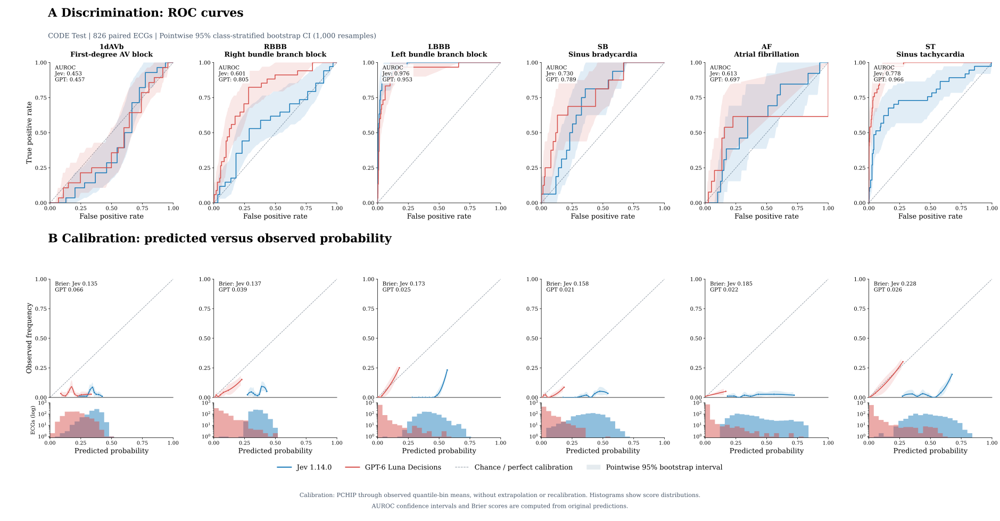

I wanted to try something simple: **what happens when we show an ECG to an AI model that was not built specifically for ECG interpretation?**

There are already good models trained on ECG signals. Here, I was curious about two newer systems that take an image and return a structured decision. Would they recognize common ECG findings? And when they say YES or NO, how meaningful are their probabilities?

This is an exploratory experiment, not a clinical diagnostic tool. The experimental inputs and analysis scripts are retained in private research repositories.

## The models

I tested **[Jev 1.14.0](https://www.typesafe.ai/)** and **GPT-6 Luna Decisions**, accessed through [OpenAI's Decisions API](https://platform.openai.com/docs/).

Both belong to a category I refer to here as *System-One AI*: models designed to make direct, structured decisions instead of writing long explanations. The name is an analogy, not a claim about how these networks think.

Both APIs can look at an image and answer questions such as “Is atrial fibrillation present?” They return YES or NO and a probability for each answer. That gives us more to evaluate than a binary prediction alone.

## The ECGs

I used **827 exams from the CODE Test dataset**. The original recordings are digital signals, but the models only saw images of twelve-lead ECGs.

The images were created using [ecg-plot](https://github.com/dy1901/ecg-plot), in the same Sangha-style layout used in an earlier ECG image study. The rendered images and labels are retained as research materials.

We evaluated six findings:

| Label | Finding | Positive exams |
|:--|:--|--:|
| 1dAVb | First-degree AV block | 28 |
| RBBB | Right bundle branch block | 34 |
| LBBB | Left bundle branch block | 30 |
| SB | Sinus bradycardia | 16 |
| AF | Atrial fibrillation | 13 |
| ST | Sinus tachycardia | 37 |

**This is a multilabel task.** One ECG can have more than one finding. And an ECG with none of these six labels is not necessarily normal.

I resized each image once, keeping its aspect ratio, and sent the same PNG to both APIs. Neither received the raw signals, clinical history, or correct labels. The resizing itself may hide small details, which is one limitation of this setup.

## What I asked

I kept the prompt short on purpose. I did not give the models a list of cardiology rules. For each finding, I asked:

```text
Assess the 12-lead ECG image in `ecg_image`.
Is {condition} present?
Evaluate this finding independently of other diagnoses.

YES: {condition} is present
NO:  {condition} is absent
```

For atrial fibrillation, `{condition}` becomes `Atrial fibrillation`. GPT Decisions received the equivalent independent questions, using its own API format.

The complete request payloads and inference scripts are retained privately for reproducibility.

One example illustrates why the probabilities matter. On ECG `ecg_0`, both models correctly answered **NO** for LBBB. But Jev assigned **0.49** to YES, while GPT Decisions assigned **0.00**. The decisions matched, but the models expressed very different levels of certainty.

These are probabilities returned by the APIs, not validated estimates of clinical risk.

## How I measured performance

Jev returned predictions for all 827 images. GPT Decisions succeeded on 826 and failed on `ecg_818`. I excluded that image from **both** models so the comparison uses exactly the same **826 ECGs**.

I focused on two questions.

**Discrimination:** does a model give higher scores to ECGs that truly have a finding? I measured this with the area under the ROC curve (**AUROC**). A value near 0.5 indicates little ability to rank positive and negative cases. A value near 1.0 is much better.

**Calibration:** when a model says 70%, does the finding actually occur about 70% of the time among exams with that predicted probability? A model can rank cases well while reporting poor probabilities.

I also calculated the **Brier Score**, the average squared difference between the predicted probability and the true label. Lower is better. Brier reflects both probability calibration and discrimination, so it should not be treated as a pure calibration measure.

## Results

<div class="column-screen-inset">
<div style="overflow-x:auto; margin: 1rem auto;">

</div>
</div>

*Figure 1.* **Top:** ROC curves for the six findings. The values marked **AUROC** show the area under each curve. **Bottom:** predicted versus observed probabilities, with score histograms. The dashed line marks perfect calibration. Shaded regions show pointwise 95% bootstrap intervals from 1,000 stratified resamples. Calibration curves use shape-preserving PCHIP interpolation between observed bin means, without extrapolating beyond the data. The interpolation changes the display, not the model predictions.

| Finding | Jev AUROC | GPT AUROC | Jev Brier ↓ | GPT Brier ↓ |
|:--|--:|--:|--:|--:|
| 1dAVb | 0.453 | 0.457 | 0.135 | 0.066 |
| RBBB | 0.601 | **0.805** | 0.137 | 0.039 |
| LBBB | **0.976** | 0.953 | 0.173 | 0.025 |
| SB | 0.730 | **0.789** | 0.158 | 0.021 |
| AF | 0.613 | **0.697** | 0.185 | 0.022 |
| ST | 0.778 | **0.966** | 0.228 | 0.026 |

GPT Decisions had a higher macro-AUROC (**0.778 versus 0.692**) and a lower mean Brier Score (**0.033 versus 0.169**). Jev did particularly well on LBBB, with an AUROC of **0.976**.

The differences across findings are striking. For some diagnoses, the models could rank exams fairly well. For others, especially first-degree AV block, they struggled.

I would not draw strong clinical conclusions from these numbers. Only 13 exams were positive for AF and 16 for SB. That makes calibration estimates especially uncertain. The shaded intervals describe uncertainty within this sample, not a formal statistical test of which model is better. A prevalence-only baseline would also be useful when interpreting Brier Scores.

## How does this compare with an ECG-specific model?

Sangha et al. (2022) trained a model specifically to classify ECG images. Their paper reports results on the cardiologist-validated **CODE Test set of 827 ECGs**, which is the same cohort used in this experiment. Below are the AUROCs for all six diagnoses, taken directly from **Table 1** of their paper.

| Finding | Sangha image model AUROC (95% CI) |
|:--|--:|
| First-degree AV block (1dAVb) | 0.995 (0.991–0.999) |
| Right bundle branch block (RBBB) | 0.995 (0.992–0.999) |
| Left bundle branch block (LBBB) | 1.000 (1.000–1.000) |
| Sinus bradycardia (SB) | 0.997 (0.994–1.000) |
| Atrial fibrillation (AF) | 0.997 (0.993–1.000) |
| Sinus tachycardia (ST) | 0.998 (0.996–1.000) |

*Source: Sangha et al., Nature Communications (2022), Table 1, image-based model, cardiologist-validated test set (N = 827). The reported class-weighted mean AUROC was 0.997 (95% CI 0.994–1.000).*

These are impressive results for a model trained specifically on ECG images. They also give useful context for our exploratory experiment. The published numbers and our API results are not an exactly matched head-to-head evaluation: our paired analysis uses 826 ECGs, and image preprocessing and model development differ. See the [original study](https://doi.org/10.1038/s41467-022-29153-3) for the full evaluation.

## Where to go next

The CODE Test is a useful starting point, but it is small for this kind of evaluation. I would like to repeat the experiment on larger and more varied collections.

**[PTB-XL](https://physionet.org/content/ptb-xl/1.0.3/)** contains 21,799 ECG recordings and many diagnostic labels. It could help us see whether these findings hold with more exams and different conditions.

The **[George B. Moody PhysioNet Challenge 2024](https://moody-challenge.physionet.org/2024/)** is another interesting direction because it includes ECG images with different layouts and visual artifacts. That would test something the clean CODE renderings cannot: how robust the models are to the kinds of images we see outside a controlled benchmark.

**Update, October 2026:** We have now completed the larger experiment. Read the [PTB-XL follow-up with 21,796 paired ECGs, AUROC, calibration and F1-score](../system-one-ptbxl/index.qmd). The PhysioNet Challenge 2024 remains a separate evaluation protocol.

## Final thoughts

Both models could read an ECG image and return structured answers. That alone is interesting, but it does not mean they can interpret ECGs reliably.

GPT Decisions generally performed better in this experiment, while Jev showed strong discrimination for LBBB. More importantly, the experiment reminded me that **making a decision, ranking cases correctly, and assigning useful probabilities are different abilities**.

The inference code, figure-generation scripts and rendered CODE Test images are retained privately for reproducibility.

## References

1. Sangha V, Mortazavi BJ, Haimovich AD, et al. (2022). [Automated multilabel diagnosis on electrocardiographic images and signals](https://doi.org/10.1038/s41467-022-29153-3). *Nature Communications*, 13, 1583. Primary source for the specialist model and its CODE Test AUROCs.
2. Ribeiro AH, Ribeiro MH, Paixão GMM, et al. (2020). [Automatic diagnosis of the 12-lead ECG using a deep neural network](https://doi.org/10.1038/s41467-020-15432-4). *Nature Communications*, 11, 1760. Background on the CODE study and ECG classification.
3. Wagner P, Strodthoff N, Bousseljot RD, et al. (2020). [PTB-XL, a large publicly available electrocardiography dataset](https://doi.org/10.1038/s41597-020-0495-6). *Scientific Data*, 7, 154. Reference for the proposed larger evaluation.
4. [George B. Moody PhysioNet Challenge 2024](https://moody-challenge.physionet.org/2024/). ECG image digitization and classification challenge.
5. [ecg-plot](https://github.com/dy1901/ecg-plot). Library used to render ECG signals as images.
6. CODE Test rendered ECG images and labels (private research materials).
7. Jev and GPT Decisions experiment code (private research materials).
8. [TypeSafe AI](https://www.typesafe.ai/) and [OpenAI API documentation](https://platform.openai.com/docs/). Model and API references.
