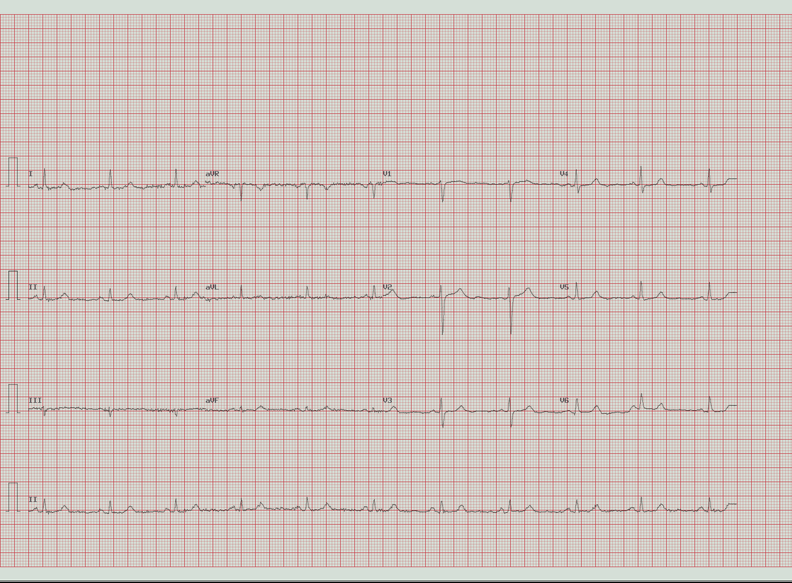
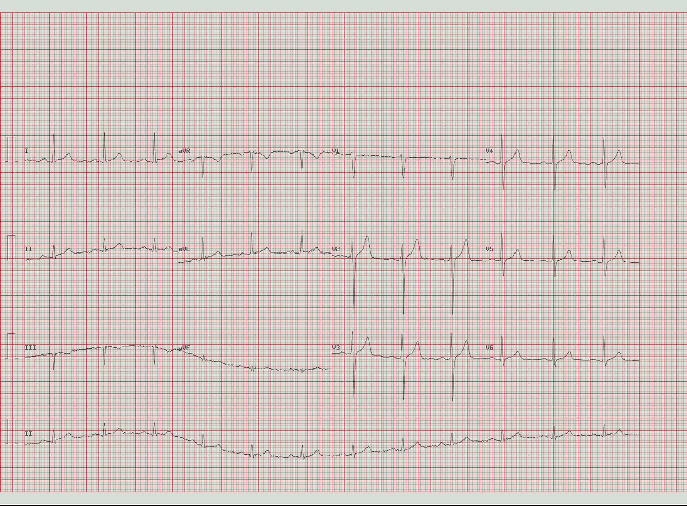

These examples are original benchmark inputs. Their saved answer objects are reproduced below with no changes to choices, confidence values or probabilities. Reference labels are evaluation metadata and were never sent to the models. These two illustrative cases are not a representative performance sample.

### PTB-XL ECG ID 1

{fig-alt="PTB-XL ECG ID 1: twelve-lead tracing used in the recorded evaluation" width="100%"}

**Reference labels:** NORM.

The following compact view retains the exact returned choices and YES probabilities. The model outputs have not been corrected to match the reference labels.

```json
{
  "jev": {
    "NORM": {"choice": "NO", "p_yes": 0.09},
    "MI": {"choice": "YES", "p_yes": 0.54},
    "STTC": {"choice": "YES", "p_yes": 0.81},
    "CD": {"choice": "NO", "p_yes": 0.34},
    "HYP": {"choice": "NO", "p_yes": 0.22}
  },
  "gpt-decisions": {
    "NORM": {"choice": "NO", "p_yes": 0.03},
    "MI": {"choice": "NO", "p_yes": 0.01},
    "STTC": {"choice": "YES", "p_yes": 0.8},
    "CD": {"choice": "NO", "p_yes": 0.0},
    "HYP": {"choice": "NO", "p_yes": 0.0}
  }
}
```

[Download the saved answer objects and reference labels](example-1-outputs.json).

<details>
<summary>Show saved JSON with YES/NO probabilities and confidence</summary>

The `answers` and `model` fields below are copied from the saved run records. The outer object pairs both models with the benchmark labels. This is not a complete HTTP response.

```json
{
  "image": "PTB-XL 1",
  "reference_labels": {
    "NORM": 1,
    "MI": 0,
    "STTC": 0,
    "CD": 0,
    "HYP": 0
  },
  "jev": {
    "model": "jev-1.14.0",
    "answers": {
      "NORM": {
        "type": "choice",
        "choice": "NO",
        "confidence": 0.82,
        "probabilities": {
          "YES": 0.09,
          "NO": 0.91
        }
      },
      "MI": {
        "type": "choice",
        "choice": "YES",
        "confidence": 0.08,
        "probabilities": {
          "YES": 0.54,
          "NO": 0.46
        }
      },
      "STTC": {
        "type": "choice",
        "choice": "YES",
        "confidence": 0.62,
        "probabilities": {
          "YES": 0.81,
          "NO": 0.19
        }
      },
      "CD": {
        "type": "choice",
        "choice": "NO",
        "confidence": 0.32,
        "probabilities": {
          "YES": 0.34,
          "NO": 0.66
        }
      },
      "HYP": {
        "type": "choice",
        "choice": "NO",
        "confidence": 0.56,
        "probabilities": {
          "YES": 0.22,
          "NO": 0.78
        }
      }
    }
  },
  "gpt-decisions": {
    "model": "gpt-6-luna",
    "answers": {
      "NORM": {
        "type": "choice",
        "choice": "NO",
        "confidence": 0.94,
        "probabilities": {
          "YES": 0.03,
          "NO": 0.97
        }
      },
      "MI": {
        "type": "choice",
        "choice": "NO",
        "confidence": 0.98,
        "probabilities": {
          "YES": 0.01,
          "NO": 0.99
        }
      },
      "STTC": {
        "type": "choice",
        "choice": "YES",
        "confidence": 0.6,
        "probabilities": {
          "YES": 0.8,
          "NO": 0.2
        }
      },
      "CD": {
        "type": "choice",
        "choice": "NO",
        "confidence": 1.0,
        "probabilities": {
          "YES": 0.0,
          "NO": 1.0
        }
      },
      "HYP": {
        "type": "choice",
        "choice": "NO",
        "confidence": 1.0,
        "probabilities": {
          "YES": 0.0,
          "NO": 1.0
        }
      }
    }
  }
}
```

</details>

### PTB-XL ECG ID 8

{fig-alt="PTB-XL ECG ID 8: twelve-lead tracing used in the recorded evaluation" width="100%"}

**Reference labels:** MI.

The following compact view retains the exact returned choices and YES probabilities. The model outputs have not been corrected to match the reference labels.

```json
{
  "jev": {
    "NORM": {"choice": "NO", "p_yes": 0.13},
    "MI": {"choice": "NO", "p_yes": 0.47},
    "STTC": {"choice": "YES", "p_yes": 0.73},
    "CD": {"choice": "NO", "p_yes": 0.31},
    "HYP": {"choice": "YES", "p_yes": 0.54}
  },
  "gpt-decisions": {
    "NORM": {"choice": "NO", "p_yes": 0.0},
    "MI": {"choice": "NO", "p_yes": 0.23},
    "STTC": {"choice": "YES", "p_yes": 0.81},
    "CD": {"choice": "NO", "p_yes": 0.0},
    "HYP": {"choice": "NO", "p_yes": 0.35}
  }
}
```

[Download the saved answer objects and reference labels](example-8-outputs.json).

<details>
<summary>Show saved JSON with YES/NO probabilities and confidence</summary>

The `answers` and `model` fields below are copied from the saved run records. The outer object pairs both models with the benchmark labels. This is not a complete HTTP response.

```json
{
  "image": "PTB-XL 8",
  "reference_labels": {
    "NORM": 0,
    "MI": 1,
    "STTC": 0,
    "CD": 0,
    "HYP": 0
  },
  "jev": {
    "model": "jev-1.14.0",
    "answers": {
      "NORM": {
        "type": "choice",
        "choice": "NO",
        "confidence": 0.74,
        "probabilities": {
          "YES": 0.13,
          "NO": 0.87
        }
      },
      "MI": {
        "type": "choice",
        "choice": "NO",
        "confidence": 0.06,
        "probabilities": {
          "YES": 0.47,
          "NO": 0.53
        }
      },
      "STTC": {
        "type": "choice",
        "choice": "YES",
        "confidence": 0.46,
        "probabilities": {
          "YES": 0.73,
          "NO": 0.27
        }
      },
      "CD": {
        "type": "choice",
        "choice": "NO",
        "confidence": 0.38,
        "probabilities": {
          "YES": 0.31,
          "NO": 0.69
        }
      },
      "HYP": {
        "type": "choice",
        "choice": "YES",
        "confidence": 0.08,
        "probabilities": {
          "YES": 0.54,
          "NO": 0.46
        }
      }
    }
  },
  "gpt-decisions": {
    "model": "gpt-6-luna",
    "answers": {
      "NORM": {
        "type": "choice",
        "choice": "NO",
        "confidence": 1.0,
        "probabilities": {
          "YES": 0.0,
          "NO": 1.0
        }
      },
      "MI": {
        "type": "choice",
        "choice": "NO",
        "confidence": 0.54,
        "probabilities": {
          "YES": 0.23,
          "NO": 0.77
        }
      },
      "STTC": {
        "type": "choice",
        "choice": "YES",
        "confidence": 0.62,
        "probabilities": {
          "YES": 0.81,
          "NO": 0.19
        }
      },
      "CD": {
        "type": "choice",
        "choice": "NO",
        "confidence": 1.0,
        "probabilities": {
          "YES": 0.0,
          "NO": 1.0
        }
      },
      "HYP": {
        "type": "choice",
        "choice": "NO",
        "confidence": 0.3,
        "probabilities": {
          "YES": 0.35,
          "NO": 0.65
        }
      }
    }
  }
}
```

</details>
