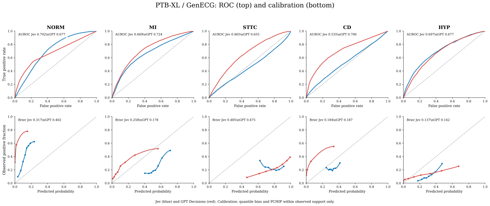

In my [first experiment](../system-one-ecg/index.qmd), I gave Jev and GPT Decisions 827 ECG images from CODE Test. The results were interesting, but the dataset was small, and some diagnoses had very few positive examples. I ended that post by suggesting a larger test with PTB-XL.

This is that follow-up. This time, I wanted to see what happens when we ask the same kind of models to read **21,799 ECGs**, with five broader diagnostic categories. I also wanted to look beyond AUROC: what happens when we actually turn a probability into a YES or NO?

## The ECGs and the models

I used [PTB-XL version 1.0.3](https://physionet.org/content/ptb-xl/1.0.3/), a publicly available collection of 12-lead ECG recordings. Instead of sending raw signals, I used the **clean images already rendered by [GenECG](https://huggingface.co/datasets/edcci/GenECG)**. The [experiment code](https://github.com/fmenegui/jev-image-tests/tree/main/experiments/ptbxl-image) records the image source and SHA-256 checksum for each examination.

I tested **Jev 1.14.0** and **GPT-6 Luna Decisions**. Both received the same ECG PNG and five independent YES/NO questions. No signal samples, patient history or reference labels were included in the requests.

| Class | What the label means | Positive ECGs in the paired set |
|:--|:--|--:|
| NORM | Normal ECG | 9,512 |
| MI | Myocardial infarction pattern, not necessarily acute STEMI | 5,469 |
| STTC | ST-segment and T-wave abnormalities | 5,107 |
| CD | Conduction disturbances | 4,898 |
| HYP | Cardiac hypertrophy | 2,649 |

These are **multilabel** categories. An ECG may have more than one abnormality. The reference labels were derived from the PTB-XL diagnostic SCP statements, grouped into the five official diagnostic superclasses.

## The questions

I expanded the prompt from the first CODE Test experiment to make the class definitions less ambiguous. The shared instructions tell the models that the task is multilabel, that MI includes patterns of previous infarction, and that ST-T changes can coexist with other findings.

For example, the MI question was:

```text
You are evaluating a standard 12-lead ECG image.
Assess five PTB-XL diagnostic superclasses independently.
This is a MULTILABEL task.

Question: Is MI present?
Myocardial infarction pattern: pathological Q waves, QRS
or ST-T changes suggestive of myocardial infarction,
including prior infarction. This does not mean acute STEMI
specifically.

Return YES or NO.
```

The complete, exact instructions and both API request formats are in [run.py](https://github.com/fmenegui/jev-image-tests/blob/main/experiments/ptbxl-image/run.py). Each model returned a binary answer and a probability for YES.

## How I evaluated the answers

Of the 21,799 ECGs, **21,796 had complete, valid responses from both models**. Three failed API calls were excluded from both sides. All metrics below use the same paired set.

I measured **AUROC** for discrimination and examined calibration by comparing predicted probabilities with observed frequencies. I also calculated the **Brier Score**.

For the binary decisions, I report sensitivity (Se), specificity (Spe), precision (positive predictive value), and F1-score. I used two approaches:

- **Fixed threshold 0.5:** classify as positive when the reported YES probability is at least 0.5.
- **F1-optimized threshold:** use nine of PTB-XL's ten predefined folds to select a threshold that maximizes F1, then apply it to the held-out fold. Repeat across folds and pool the held-out predictions. This is an *out-of-fold* threshold evaluation, not a threshold chosen on the cases being scored.

Threshold optimization uses PTB-XL reference labels. It is therefore a form of supervised adaptation, even though the underlying model weights were not fine-tuned.

## Discrimination and calibration



*Figure 1.* **Top:** ROC curves for each superclass. **Bottom:** observed versus predicted frequencies and distributions of predicted probabilities. The gray diagonal represents chance performance in ROC panels and perfect calibration in calibration panels. Curves were derived from the saved model probabilities, following the visualization approach used in the [CODE Test article](../system-one-ecg/index.qmd). The AUROC confidence intervals in the table below come from 300 paired patient-cluster bootstrap resamples. This website figure shows the empirical curves without uncertainty ribbons, while the full analysis also produces a version with bootstrap bands. The displayed calibration curves are interpolated for visualization, not recalibrated predictions.

| Class | Jev AUROC (95% CI) | GPT AUROC (95% CI) |
|:--|--:|--:|
| NORM | **0.702 (0.695–0.709)** | 0.677 (0.671–0.682) |
| MI | 0.669 (0.659–0.678) | **0.724 (0.715–0.731)** |
| STTC | 0.465 (0.456–0.475) | **0.655 (0.646–0.664)** |
| CD | 0.535 (0.525–0.545) | **0.706 (0.697–0.715)** |
| HYP | **0.697 (0.686–0.709)** | 0.677 (0.668–0.689) |

The most striking result is the uneven performance. Jev ranked normal ECGs and hypertrophy slightly better. GPT Decisions ranked infarction patterns, ST-T changes and conduction disturbances better. Neither performed consistently well across all five classes.

Jev's STTC AUROC of **0.465** is particularly concerning. Its scores did not meaningfully separate positive from negative cases in the expected direction.

## What happens at a threshold of 0.5?

| Class | Model | Se | Spe | Precision | F1 @ 0.5 | F1 optimized* |
|:--|:--|--:|--:|--:|--:|--:|
| NORM | Jev | 0.000 | 1.000 | 0.000 | 0.000 | **0.667** |
| | GPT | 0.004 | 1.000 | 0.952 | 0.008 | 0.608 |
| MI | Jev | 0.785 | 0.407 | 0.307 | 0.441 | 0.462 |
| | GPT | 0.180 | 0.951 | 0.551 | 0.271 | **0.507** |
| STTC | Jev | 0.997 | 0.000 | 0.234 | 0.379 | 0.380 |
| | GPT | 0.980 | 0.081 | 0.246 | 0.394 | **0.426** |
| CD | Jev | 0.012 | 0.997 | 0.513 | 0.024 | 0.367 |
| | GPT | 0.081 | 0.987 | 0.647 | 0.144 | **0.474** |
| HYP | Jev | 0.122 | 0.972 | 0.379 | 0.184 | **0.323** |
| | GPT | 0.330 | 0.855 | 0.239 | 0.278 | 0.297 |
| **Macro F1** | **Jev** | | | | **0.206** | **0.440** |
| | **GPT** | | | | **0.219** | **0.462** |

*The optimized F1 column pools predictions from ten held-out folds, with each fold's threshold selected from the other nine folds. Se, Spe and precision in this table are for the fixed 0.5 threshold.*

The threshold matters a lot. At 0.5, Jev almost never identifies NORM or CD, even though its AUROC for NORM is above 0.7. The probabilities contain some ranking information, but a generic 0.5 cutoff is a poor decision rule.

Selecting thresholds from separate folds improves macro F1 from **0.206 to 0.440** for Jev and from **0.219 to 0.462** for GPT Decisions. This should not be confused with an improvement in the underlying model or with prospective clinical validation.

## How does this compare with my PhysioNet Challenge 2024 model?

In 2024, our AIMED team developed an **ECG-specific ConvNeXt model** for the George B. Moody PhysioNet Challenge. The approach combined ImageNet pretraining, ECG-domain transfer learning and explicit fine-tuning on ECG data. It won the ECG image-classification task.

Our [Computing in Cardiology 2024 paper](https://www.cinc.org/archives/2024/pdf/CinC2024-398.pdf) reported a **macro F1-score of 0.817** on the Challenge's hidden evaluation. Internal five-fold validation reported **0.698 ± 0.022**.

| Evaluation | Macro F1 |
|:--|--:|
| Jev, PTB-XL GenECG, threshold 0.5 | 0.206 |
| GPT Decisions, PTB-XL GenECG, threshold 0.5 | 0.219 |
| Jev, PTB-XL GenECG, out-of-fold threshold | 0.440 |
| GPT Decisions, PTB-XL GenECG, out-of-fold threshold | 0.462 |
| AIMED ConvNeXt, Challenge 2024 hidden evaluation | **0.817** |

**These scores are not directly comparable.** The Challenge used a different set of diagnostic classes, a hidden evaluation set and a different image-generation and acquisition protocol. Its 0.817 result is useful context for a specialist ECG-image model, not a head-to-head benchmark on these 21,796 images.

There is another important distinction. **My ConvNeXt model was explicitly trained and fine-tuned for ECG classification. Jev and GPT Decisions were not explicitly fine-tuned on PTB-XL for this experiment.** Their broader pretraining data are not fully disclosed, so we cannot rule out previous exposure to ECG material or PTB-XL examples. The threshold-optimized results also use labeled PTB-XL examples to select thresholds. These differences are limitations, not evidence of an intrinsic model advantage.

## What I take from this

The larger dataset changes the picture from the first CODE Test experiment. Both APIs reliably produced structured outputs, but that alone did not make their ECG interpretations dependable. Some classes were ranked reasonably well, while others showed weak discrimination or highly unsuitable probability thresholds.

For me, the most useful finding is the gap between **ranking an ECG, reporting a probability, and making a binary clinical decision**. They are related tasks, but not interchangeable.

The next experiment should test the models on different ECG acquisition conditions and use an independent dataset for selecting thresholds before evaluating new cases.

## Reproducibility and references

The [inference implementation](https://github.com/fmenegui/jev-image-tests/tree/main/experiments/ptbxl-image) and the [CODE Test figure-generation reference](https://github.com/fmenegui/jev-image-tests/blob/main/experiments/code-test-image/analysis/plot_journal_final.py) document the experimental design. The figure here uses the same quantile-binning and shape-preserving interpolation approach.

1. Wagner P, Strodthoff N, Bousseljot RD, et al. [PTB-XL, a large publicly available electrocardiography dataset](https://doi.org/10.1038/s41597-020-0495-6). *Scientific Data*. 2020.
2. Dias FM, Ribeiro E, Soares QB, Krieger JE, Gutierrez MA. [Image-Based Electrocardiogram Classification Using Pre-trained ConvNeXt](https://www.cinc.org/archives/2024/pdf/CinC2024-398.pdf). *Computing in Cardiology*. 2024.
3. Reyna MA, et al. [Digitization and Classification of ECG Images: The George B. Moody PhysioNet Challenge 2024](https://moody-challenge.physionet.org/2024/papers/cinc_paper.pdf). *Computing in Cardiology*. 2024.
4. [Official Challenge 2024 results](https://moody-challenge.physionet.org/2024/results/).
5. [GenECG image collection](https://huggingface.co/datasets/edcci/GenECG).
6. [Jev and GPT Decisions experiment repository](https://github.com/fmenegui/jev-image-tests).
