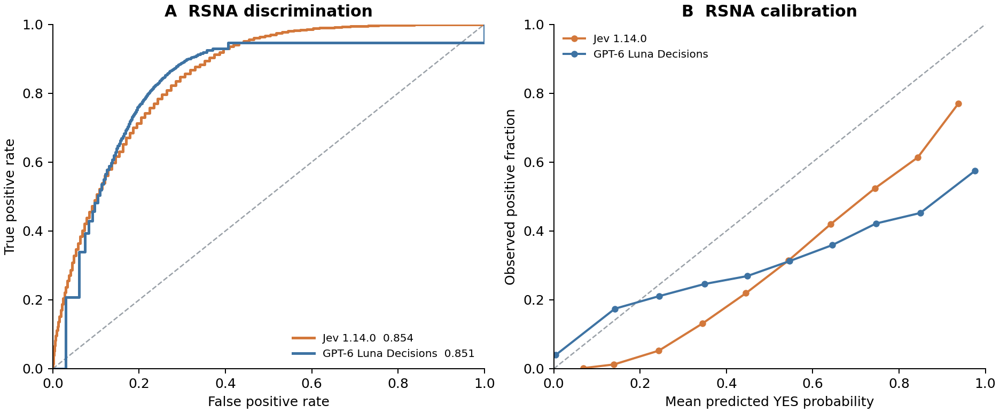
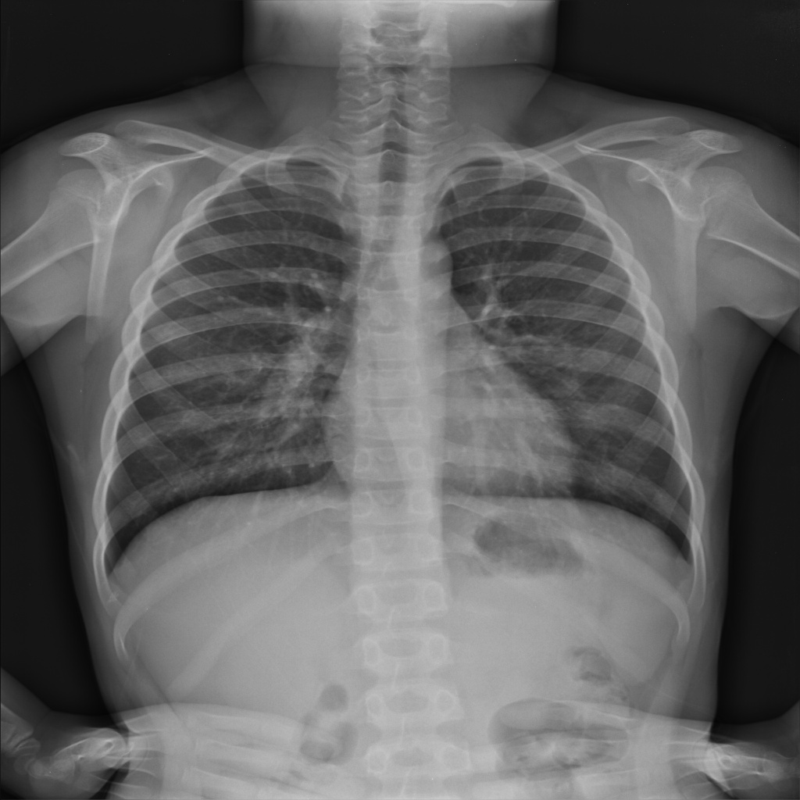
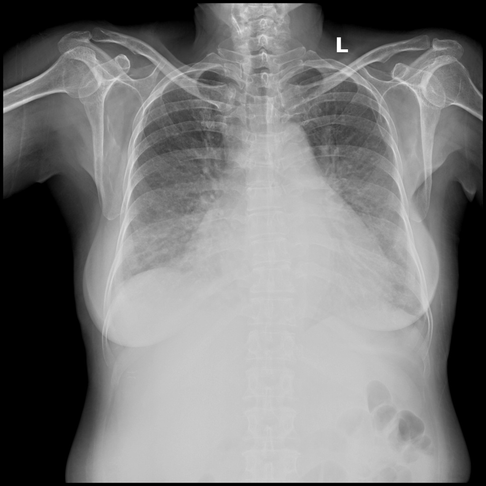
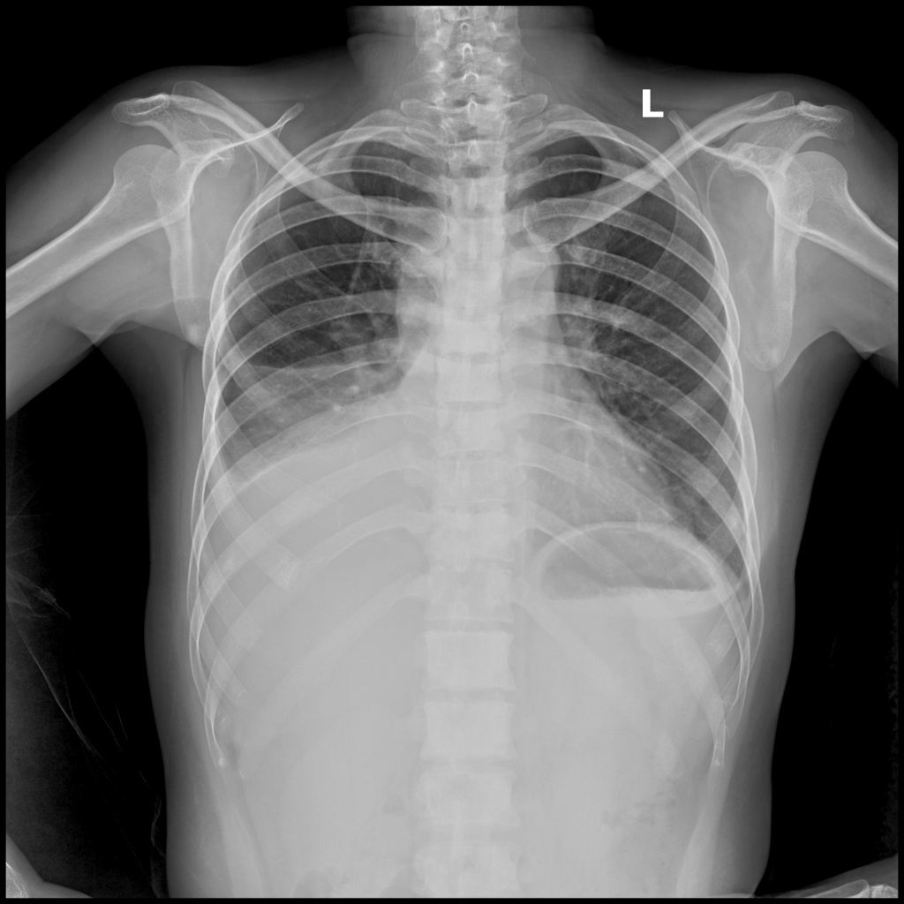

```{=html}
<p>After testing Jev and GPT Decisions on <a href="https://fmenegui.com/blog/system-one-ecg/">ECG images</a>, I wanted to try chest X-rays. The setup was similar: give both models the same image, ask about a finding, and keep the answer and its probabilities.</p>
```


```{=html}
<p>I used two public datasets: <strong>26,684 radiographs from RSNA</strong> and <strong>15,000 from VinBigData</strong>. Both models returned valid answers for every image. Their results were more interesting than a single accuracy number would suggest. Jev generally ranked VinBigData findings better, while GPT Decisions had a higher average F1. Both had substantial problems with their probability estimates.</p>
```


## What I evaluated


```{=html}
<p>I tested <strong>Jev 1.14.0</strong> and <strong>GPT-6 Luna Decisions</strong>. Each received the same PNG, equivalent finding definitions, and YES/NO options. Neither received the correct labels, a radiology report, or patient history.</p>
```


```{=html}
<p>The <a href="https://www.kaggle.com/competitions/rsna-pneumonia-detection-challenge">RSNA Pneumonia Detection Challenge</a> supplied the first cohort. Its target is a lung opacity suspicious for pneumonia. That distinction matters: agreement with this label measures recognition of a radiographic finding. It does not establish a clinical diagnosis of pneumonia. <a href="#ref-1">[1]</a></p>
```


```{=html}
<p>For <a href="https://www.kaggle.com/competitions/vinbigdata-chest-xray-abnormalities-detection">VinBigData</a>, I evaluated 14 findings independently, including cardiomegaly, pleural effusion, nodules or masses, and pneumothorax. An additional question asked whether none of the listed findings was visible. The competition labels used here do not include pneumonia. They also differ from the broader VinDr-CXR release described in the dataset paper. <a href="#ref-2">[2]</a></p>
```


```{=html}
<p>These are the public labelled training cohorts. I did not train either model on them for this experiment, but previous exposure during model development is unknown. The results describe these cohorts and image conversions.</p>
```


## RSNA results


```{=html}
<p>Of the 26,684 images, 6,012 had a positive reference label, or 22.5%. I kept that proportion instead of creating a balanced sample.</p>
```


```{=html}
<div class="table-scroll"><table><thead><tr><th scope="col">RSNA metric</th><th scope="col">Jev</th><th scope="col">GPT Decisions</th></tr></thead><tbody><tr><td>AUROC</td><td>0.854 <small>(0.849–0.858)</small></td><td>0.851 <small>(0.845–0.856)</small></td></tr><tr><td>Average precision</td><td>0.596 <small>(0.584–0.609)</small></td><td>0.563 <small>(0.551–0.575)</small></td></tr><tr><td>Sensitivity</td><td>0.790 <small>(0.780–0.801)</small></td><td>0.815 <small>(0.805–0.825)</small></td></tr><tr><td>Specificity</td><td>0.753 <small>(0.746–0.758)</small></td><td>0.768 <small>(0.763–0.774)</small></td></tr><tr><td>Precision</td><td>0.482</td><td>0.506</td></tr><tr><td>F1</td><td>0.598 <small>(0.590–0.608)</small></td><td>0.624 <small>(0.616–0.633)</small></td></tr><tr><td>Brier score ↓</td><td>0.160 <small>(0.158–0.163)</small></td><td>0.176 <small>(0.172–0.180)</small></td></tr></tbody></table></div>
```


```{=html}
<p class="xray-caption">Intervals in parentheses are 95% paired image bootstrap intervals. Binary metrics use the YES or NO returned by the API. Lower Brier scores indicate less squared probability error.</p>
```


```{=html}
<p>The AUROCs were close: 0.854 for Jev and 0.851 for GPT Decisions. The paired interval for their difference included zero, so this experiment does not clearly separate them on AUROC.</p>
```


```{=html}
<p>GPT Decisions identified 4,902 of the 6,012 positive images, compared with 4,750 for Jev. It also returned fewer false positives: 4,791 versus 5,115. That gave GPT the higher F1. Jev had higher average precision and a lower Brier score.</p>
```


```{=html}
<figure class="xray-scientific-figure" tabindex="0" role="region" aria-label="RSNA curves, scroll horizontally on small screens"><figcaption>Empirical ROC curves and calibration on the complete RSNA cohort. Calibration points show mean scores and observed positive fractions in ten equal-width bins. Connecting segments guide the eye. The plot does not show confidence bands.</figcaption></figure>
```


```{=html}
<p>The calibration plot explains why I kept the probabilities. Among GPT scores from 0.9 to 1.0, the mean was 0.976, but only 57.4% of those images had a positive reference label. Jev also overestimated positivity in that range: a mean score of 0.937 corresponded to 77.0% positives. Taking those numbers as reliable probabilities would be misleading.</p>
```


## VinBigData results


```{=html}
<p>VinBigData has three readers per image. I treated a finding as positive when at least two readers annotated it. The averages below give equal weight to each of the 14 findings. The separate “No finding” question is excluded.</p>
```


```{=html}
<div class="table-scroll"><table><thead><tr><th scope="col">VinBigData, 14 findings</th><th scope="col">Jev</th><th scope="col">GPT Decisions</th></tr></thead><tbody><tr><td>Mean AUROC</td><td>0.929</td><td>0.868</td></tr><tr><td>Mean average precision</td><td>0.444</td><td>0.375</td></tr><tr><td>Mean F1</td><td>0.312</td><td>0.339</td></tr><tr><td>Mean Brier score ↓</td><td>0.110</td><td>0.069</td></tr></tbody></table></div>
```


```{=html}
<p>Jev had the higher AUROC for 13 of the 14 findings. Cardiomegaly was the exception. Yet GPT Decisions had the higher average F1 and lower average Brier score. The models differ in how they rank images and where their YES/NO decisions fall.</p>
```


```{=html}
<p>For nodules or masses, Jev had an AUROC of 0.949 and detected 356 of 405 reference-positive images. It also produced 1,604 false positives. GPT detected 131, with 100 false positives. Jev found more of the annotated cases. GPT's positive answers were more selective. Their F1 scores were 0.301 and 0.412, respectively.</p>
```


```{=html}
<p>Some findings exposed a much larger gap between ranking and decisions. Jev's AUROC for pulmonary fibrosis was 0.901, but it answered YES for only 64 of the 1,017 positive images. GPT detected 55. For this finding, neither model's native decisions made good use of the ranking information available in its scores.</p>
```


```{=html}
<p>The probability errors also need a reference. Assigning every image the observed prevalence of each finding gives a mean Brier score of <strong>0.038</strong>, compared with <strong>0.110 for Jev</strong> and <strong>0.069 for GPT</strong>. This constant reference uses the evaluation cohort itself, so it is a descriptive comparison. Even so, it shows why GPT's lower error should not be read as evidence of dependable probabilities.</p>
```


## Three images and their recorded answers


```{=html}
<p>These images come from the technical pilot and are included in the full evaluation. I chose them to illustrate different reference findings. They are examples, not a representative sample of model performance. The displayed PNGs match the recorded input hashes. Each table shows one question, while the CSV retains all 15 answers.</p>
```


```{=html}
<div class="xray-examples"><figure class="xray-case"><h3>No finding</h3><figcaption>Reference labels: No finding.<br><code>ea21c8aba30e5357ba8b7bd388651d56</code></figcaption><div class="table-scroll"><table><thead><tr><th scope="col">Model</th><th scope="col">No finding</th><th scope="col">P(YES)</th></tr></thead><tbody><tr><td>Jev 1.14.0</td><td>NO</td><td>0.36</td></tr><tr><td>GPT-6 Luna Decisions</td><td>NO</td><td>0.10</td></tr></tbody></table></div><details><summary>Recorded answer objects and image hash</summary><p class="hash">SHA-256: <code>faa2c06604c11e75be83aabedfaff532c50590036872f203c59d5325d4693785</code></p><pre>{
  "jev": {
    "served_model": "jev-1.14.0",
    "answer": {
      "type": "choice",
      "choice": "NO",
      "confidence": 0.28,
      "probabilities": {
        "YES": 0.36,
        "NO": 0.64
      }
    }
  },
  "gpt-decisions": {
    "served_model": "gpt-6-luna",
    "answer": {
      "type": "choice",
      "name": "no_finding",
      "choice": "NO",
      "probabilities": [
        {
          "value": "YES",
          "probability": 0.1
        },
        {
          "value": "NO",
          "probability": 0.9
        }
      ],
      "confidence": 0.8
    }
  }
}</pre></details></figure><figure class="xray-case"><h3>Cardiomegaly</h3><figcaption>Reference labels: Cardiomegaly.<br><code>b5fa2fc3b3e2a3bbf93884481fb08b74</code></figcaption><div class="table-scroll"><table><thead><tr><th scope="col">Model</th><th scope="col">Cardiomegaly</th><th scope="col">P(YES)</th></tr></thead><tbody><tr><td>Jev 1.14.0</td><td>YES</td><td>0.92</td></tr><tr><td>GPT-6 Luna Decisions</td><td>YES</td><td>1.00</td></tr></tbody></table></div><details><summary>Recorded answer objects and image hash</summary><p class="hash">SHA-256: <code>2a93155740a93ba946e0a92918679aaa882445dd5bfb3764733ad4d120aa3a0d</code></p><pre>{
  "jev": {
    "served_model": "jev-1.14.0",
    "answer": {
      "type": "choice",
      "choice": "YES",
      "confidence": 0.84,
      "probabilities": {
        "YES": 0.92,
        "NO": 0.08
      }
    }
  },
  "gpt-decisions": {
    "served_model": "gpt-6-luna",
    "answer": {
      "type": "choice",
      "name": "cardiomegaly",
      "choice": "YES",
      "probabilities": [
        {
          "value": "YES",
          "probability": 1.0
        },
        {
          "value": "NO",
          "probability": 0.0
        }
      ],
      "confidence": 1.0
    }
  }
}</pre></details></figure><figure class="xray-case"><h3>Pleural effusion</h3><figcaption>Reference labels: Lung Opacity, Pleural effusion, Pulmonary fibrosis.<br><code>05c0c802db4f100de8e2a9fa4aa62d14</code></figcaption><div class="table-scroll"><table><thead><tr><th scope="col">Model</th><th scope="col">Pleural effusion</th><th scope="col">P(YES)</th></tr></thead><tbody><tr><td>Jev 1.14.0</td><td>YES</td><td>0.99</td></tr><tr><td>GPT-6 Luna Decisions</td><td>YES</td><td>1.00</td></tr></tbody></table></div><p class="xray-caption">Both models also answered NO for pulmonary fibrosis, which is positive in the majority reference: Jev P(YES) = 0.04, GPT P(YES) = 0.00.</p><details><summary>Recorded answer objects and image hash</summary><p class="hash">SHA-256: <code>6c9c2396748b6a7bbb5bbc6c8c34acf7e515b49cdfe1e9a821c1168c49467903</code></p><pre>{
  "jev": {
    "served_model": "jev-1.14.0",
    "answer": {
      "type": "choice",
      "choice": "YES",
      "confidence": 0.98,
      "probabilities": {
        "YES": 0.99,
        "NO": 0.01
      }
    },
    "pulmonary_fibrosis_answer": {
      "type": "choice",
      "choice": "NO",
      "confidence": 0.92,
      "probabilities": {
        "YES": 0.04,
        "NO": 0.96
      }
    }
  },
  "gpt-decisions": {
    "served_model": "gpt-6-luna",
    "answer": {
      "type": "choice",
      "name": "pleural_effusion",
      "choice": "YES",
      "probabilities": [
        {
          "value": "YES",
          "probability": 1.0
        },
        {
          "value": "NO",
          "probability": 0.0
        }
      ],
      "confidence": 1.0
    },
    "pulmonary_fibrosis_answer": {
      "type": "choice",
      "name": "pulmonary_fibrosis",
      "choice": "NO",
      "probabilities": [
        {
          "value": "YES",
          "probability": 0.0
        },
        {
          "value": "NO",
          "probability": 1.0
        }
      ],
      "confidence": 1.0
    }
  }
}</pre></details></figure></div>
```


## What I take from this experiment


```{=html}
<p>The chest X-ray results were stronger than several of the ECG results I obtained earlier, although the datasets and tasks differ. Jev's discrimination on VinBigData was particularly interesting. The same evaluation also showed how much that result can hide: missed findings, large numbers of false positives, and probabilities that do not match observed frequencies.</p>
```


```{=html}
<p>For me, the next useful experiment is to select thresholds and calibrate the scores on a separate development set, then evaluate them on new data. That would test how much of the problem can be corrected without changing the models. It would also make the comparison more useful than choosing a winner from AUROC alone.</p>
```


## Data behind the results


```{=html}
<p>The downloads contain one row per image and model: <strong>53,368 RSNA rows</strong> and <strong>30,000 VinBigData rows</strong>. Each row includes the PNG hash, reference labels, model identity, reconstructed request JSON, the saved output record, and separate columns for choices and probabilities. VinBigData also includes the reader votes and alternative reference definitions.</p>
```


```{=html}
<p>The CSVs contain no image bytes. Images remain available through the original dataset sources. The request JSON replaces image bytes with a placeholder tied to the recorded hash. The saved outputs preserve the fields retained by the experiment adapter, rather than claiming to be complete HTTP response logs.</p>
```


```{=html}
<p><a class="xray-download" download="rsna-responses.csv.gz" href="data/rsna-responses.csv.gz">Download RSNA CSV · 53,368 rows</a><br><small>SHA-256: <code>8c3d88b49f77023fc09c086b2537ab216348adbb23e2ce02f62b41948e8f7138</code></small></p>
```


```{=html}
<p><a class="xray-download" download="vinbigdata-responses.csv.gz" href="data/vinbigdata-responses.csv.gz">Download VinBigData CSV · 30,000 rows</a><br><small>SHA-256: <code>b20e4449619ed922b1a070a19a5fe64f04d462d7c068330975f5809f19d09d3a</code></small></p>
```


```{=html}
<details class="technical-appendix"><summary>Technical appendix · methods, all findings, and data notes</summary>
<h3>Image processing and prompts</h3>
<p>RSNA DICOM pixels were clipped using each image's 0.5th and 99.5th percentiles, scaled to 8-bit grayscale, inverted for MONOCHROME1 when needed, converted to RGB, and fitted within 1024 × 1024 pixels with aspect ratio preserved. Both models received the same resulting PNG.</p>
<p>VinBigData used version 1 of <a href="https://www.kaggle.com/datasets/sunghyunjun/vinbigdata-1024-jpg-dataset">sunghyunjun/vinbigdata-1024-jpg-dataset</a>, a participant's 1024 × 1024 JPEG conversion. Its documented conversion applies VOI LUT, monochrome correction, per-image scaling, square resizing, and JPEG compression. I decoded each JPEG to an RGB PNG without another resize. This is an evaluation of that representation, not the original DICOM pixels.</p>
<p>The exact RSNA question was:</p><blockquote>Assess the supplied frontal chest radiograph image. Does it show a focal pulmonary opacity suspicious for pneumonia? Answer YES if a pulmonary opacity suspicious for pneumonia is present, otherwise NO. Other abnormalities without suspicious pulmonary opacity are NO. Judge the image alone, without patient history. This is a research benchmark, not a clinical diagnosis.</blockquote>
<p>For VinBigData, all 15 questions were sent in one image request per model. Each finding was assessed independently. The shared instruction was:</p><blockquote>Assess only the supplied frontal chest radiograph. Evaluate each listed radiographic finding independently. Several findings may coexist. For no_finding, answer YES only when none of the other fourteen findings is visible. Judge the image without patient history or a reference report. This is a research image benchmark, not a clinical diagnosis.</blockquote>
<p>The CSV includes every finding definition, option description, and reconstructed API payload. Requested aliases were <code>jev-preview</code> and <code>gpt-6-luna</code>. The recorded served models were <code>jev-1.14.0</code> and <code>gpt-6-luna</code> for all included records. Scores and native choices are retained separately. No new inference calls were made to prepare this post.</p>
<h3>Reference labels and denominators</h3>
<p>RSNA uses all 26,684 unique images in the stage-2 training label file, including 6,012 positives. Blind competition test images are excluded. Multiple boxes from one image do not create additional observations.</p>
<p>The VinBigData label file contains 67,914 annotation rows for 15,000 images. I collapsed boxes to presence or absence per reader and finding, then used at least two of three readers as the primary reference. The CSV also preserves union and unanimous references. Absence of a box follows the competition's annotation convention. It is not proof of clinical absence. “No finding” remains its own annotated category and is not treated as a clinical declaration of health.</p>
<p>The three illustrated inputs were selected by the technical pilot's coverage procedure. They were not a separate validation cohort. Their answer objects are copied from the saved records. The displayed images have no added boxes or diagnostic overlays.</p>
<h3>Metrics and uncertainty</h3>
<p>AUROC measures ranking across thresholds. Average precision is the value computed by <code>average_precision_score</code>, not trapezoidal integration of a precision-recall curve. Sensitivity, specificity, precision, and F1 use native API choices. No thresholds were optimized and no probability calibration was fitted for the reported results. When P(YES) was exactly 0.50, the returned choice sometimes remained NO. This occurs in 190 RSNA model-image decisions and 807 VinBigData model-image-finding decisions. Native choices are preserved rather than overwritten with a threshold rule.</p>
<p>Brier score is the mean squared difference between P(YES) and the binary reference label. It measures probability error, which depends on both calibration and discrimination. Lower Brier alone does not establish good calibration. The constant prevalence reference is calculated within this cohort and is not an independently fitted prediction model.</p>
<p>Both saved analyses use 1,000 bootstrap replicates with seed 42, resampling images while preserving the two models' pairing. VinBigData resamples all findings together for each image. The intervals do not account for unknown repeated-patient clustering. Per-finding comparisons are exploratory and are not adjusted for multiple testing. Macro summaries are descriptive averages, without a separately estimated macro confidence interval.</p>
<p>For RSNA, the 95% interval for GPT minus Jev AUROC is −0.0067 to 0.0018. The corresponding intervals are −0.0443 to −0.0237 for average precision, 0.0128 to 0.0189 for Brier, and 0.0186 to 0.0334 for F1.</p>
<h3>All VinBigData findings</h3>
<div class="table-scroll"><table><thead><tr><th scope="col">Finding</th><th scope="col">Positive images</th><th scope="col">Jev AUROC (95% CI)</th><th scope="col">GPT AUROC (95% CI)</th><th scope="col">AP Jev / GPT</th><th scope="col">F1 Jev / GPT</th><th scope="col">Brier Jev / GPT</th></tr></thead><tbody><tr><td>Aortic enlargement</td><td>2,346</td><td>0.868 (0.861–0.874)</td><td>0.846 (0.839–0.854)</td><td>0.552 / 0.498</td><td>0.537 / 0.514</td><td>0.118 / 0.137</td></tr><tr><td>Atelectasis</td><td>62</td><td>0.882 (0.851–0.909)</td><td>0.876 (0.832–0.915)</td><td>0.022 / 0.025</td><td>0.024 / 0.040</td><td>0.232 / 0.125</td></tr><tr><td>Calcification</td><td>177</td><td>0.946 (0.929–0.960)</td><td>0.920 (0.899–0.936)</td><td>0.283 / 0.127</td><td>0.052 / 0.099</td><td>0.290 / 0.153</td></tr><tr><td>Cardiomegaly</td><td>1,817</td><td>0.929 (0.924–0.934)</td><td>0.934 (0.929–0.939)</td><td>0.686 / 0.682</td><td>0.537 / 0.629</td><td>0.069 / 0.078</td></tr><tr><td>Consolidation</td><td>121</td><td>0.973 (0.966–0.980)</td><td>0.963 (0.944–0.981)</td><td>0.268 / 0.281</td><td>0.162 / 0.272</td><td>0.062 / 0.028</td></tr><tr><td>ILD</td><td>152</td><td>0.972 (0.962–0.981)</td><td>0.954 (0.936–0.972)</td><td>0.467 / 0.260</td><td>0.437 / 0.366</td><td>0.014 / 0.013</td></tr><tr><td>Infiltration</td><td>245</td><td>0.969 (0.961–0.976)</td><td>0.954 (0.941–0.966)</td><td>0.416 / 0.325</td><td>0.173 / 0.303</td><td>0.118 / 0.050</td></tr><tr><td>Lung Opacity</td><td>547</td><td>0.939 (0.930–0.947)</td><td>0.923 (0.911–0.934)</td><td>0.383 / 0.342</td><td>0.136 / 0.211</td><td>0.331 / 0.202</td></tr><tr><td>Nodule/Mass</td><td>405</td><td>0.949 (0.938–0.959)</td><td>0.834 (0.811–0.855)</td><td>0.486 / 0.388</td><td>0.301 / 0.412</td><td>0.094 / 0.021</td></tr><tr><td>Other lesion</td><td>362</td><td>0.831 (0.810–0.851)</td><td>0.684 (0.657–0.710)</td><td>0.132 / 0.088</td><td>0.192 / 0.081</td><td>0.084 / 0.025</td></tr><tr><td>Pleural effusion</td><td>634</td><td>0.972 (0.965–0.977)</td><td>0.963 (0.952–0.972)</td><td>0.767 / 0.829</td><td>0.702 / 0.786</td><td>0.022 / 0.015</td></tr><tr><td>Pleural thickening</td><td>882</td><td>0.884 (0.873–0.894)</td><td>0.727 (0.711–0.742)</td><td>0.421 / 0.369</td><td>0.278 / 0.170</td><td>0.054 / 0.051</td></tr><tr><td>Pneumothorax</td><td>58</td><td>0.998 (0.996–0.999)</td><td>0.939 (0.893–0.978)</td><td>0.818 / 0.810</td><td>0.717 / 0.766</td><td>0.003 / 0.001</td></tr><tr><td>Pulmonary fibrosis</td><td>1,017</td><td>0.901 (0.890–0.911)</td><td>0.628 (0.615–0.642)</td><td>0.518 / 0.232</td><td>0.117 / 0.101</td><td>0.050 / 0.063</td></tr><tr><td>No finding</td><td>10,606</td><td>0.907 (0.901–0.912)</td><td>0.902 (0.896–0.907)</td><td>0.953 / 0.948</td><td>0.742 / 0.848</td><td>0.195 / 0.147</td></tr></tbody></table></div>
<p class="xray-caption">Primary reference: at least two readers. AP means average precision. Paired models use the same 15,000 images for every finding. “No finding” is shown for completeness and excluded from the 14-finding averages.</p>
<p>The small numbers of positives for pneumothorax (58) and atelectasis (62) deserve attention even in a 15,000-image cohort. A large total sample does not make every finding equally well represented.</p>
<h3>CSV interpretation</h3>
<p>The downloads are UTF-8 CSV files compressed with gzip. Quoted cells preserve JSON. Every image has one Jev row and one GPT Decisions row. Each finding has a reference label, native choice, binary prediction, P(YES), P(NO), and the API's separate confidence field. The confidence field is retained as returned and should not be substituted for P(YES).</p>
<p>VinBigData retains the anonymous Kaggle image identifier. RSNA retains the experiment's pseudonymous identifier because the original DICOM identifiers were not included in these result artifacts. The SHA-256 applies to the exact PNG sent to the models, not the source JPEG or DICOM. Matching an RSNA file therefore requires reproducing the documented conversion and comparing its hash.</p>
<p>Request JSON was reconstructed from the executed adapters. The image placeholder must be replaced with the PNG matching that row's hash. Saved output records contain the returned answer fields and the metadata retained by those adapters. They do not recover discarded HTTP headers or response fields. No API keys, authentication headers, source images, or reproduction scripts are included in the CSVs.</p>
<p>Successful responses were restored from checkpoints when jobs resumed. This avoids deliberately repeating completed work, but a lost worker before checkpoint upload could still have caused an additional request. The exported files describe the consolidated successful records, not a billing ledger or repeated-sampling study.</p>
<p>These are retrospective public-cohort evaluations of image-level findings. They do not measure lesion localization, report quality, performance against clinicians on the same cases, or clinical benefit. Public training-set exposure during foundation-model development remains unknown.</p>
</details>
```


## References


```{=html}
<ol>
<li id="ref-1">Shih G, Wu CC, Halabi SS, et al. <a href="https://doi.org/10.1148/ryai.2019180041">Augmenting the National Institutes of Health Chest Radiograph Dataset with Expert Annotations of Possible Pneumonia.</a> <em>Radiology: Artificial Intelligence.</em> 2019. <a href="https://www.kaggle.com/competitions/rsna-pneumonia-detection-challenge">RSNA competition data.</a></li>
<li id="ref-2">Nguyen HQ, Lam K, Le LT, et al. <a href="https://doi.org/10.1038/s41597-022-01498-w">VinDr-CXR: An open dataset of chest X-rays with radiologist's annotations.</a> <em>Scientific Data.</em> 2022. <a href="https://www.kaggle.com/competitions/vinbigdata-chest-xray-abnormalities-detection">VinBigData competition.</a> The experiment uses the competition's reduced finding taxonomy, not all 28 VinDr-CXR labels.</li>
<li><a href="https://www.kaggle.com/datasets/sunghyunjun/vinbigdata-1024-jpg-dataset">VinBigData 1024 JPG Dataset, version 1.</a> Image representation used for this evaluation. <a href="https://github.com/sunghyunjun/kaggle-vinbigdata-chest-xray-abnormalities-detection/blob/main/prepare_data.py">Uploader's conversion method.</a></li>
</ol>
```
